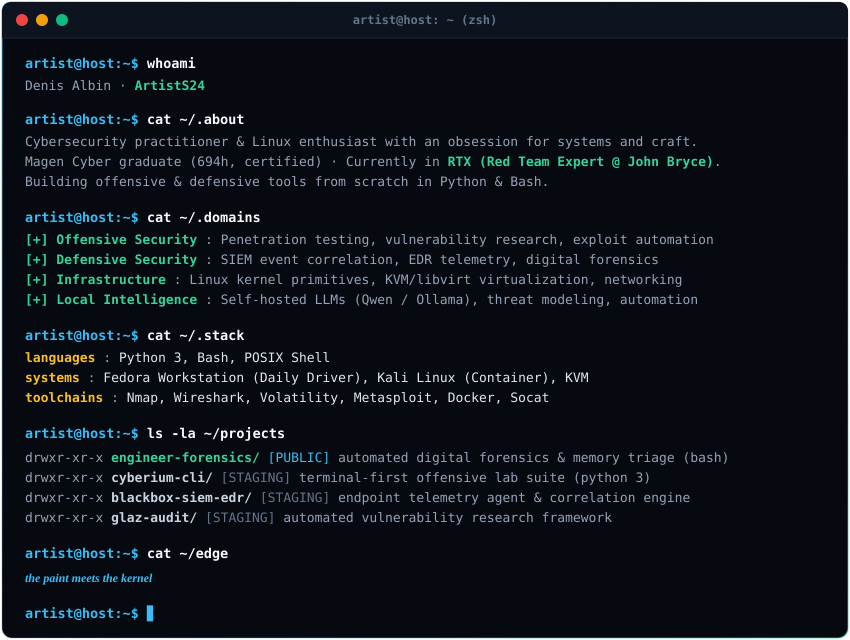

<div align="center">



<br/>

[](https://digitalcredentials.cityandguilds.com/profile/denisalbin263984/wallet)
[](mailto:albindeniswork@gmail.com)

</div>

<pre>
<b>artist@host</b>:<b>~</b>$ ls -la ~/projects/
total 24
drwxr-xr-x  6 artist artist 4096 Oct 16 00:05 .
drwxr-xr-x 18 artist artist 4096 Oct 16 00:00 ..
drwxr-xr-x  3 artist artist 4096 Oct 16 00:05 <a href="https://github.com/ArtistS24/Engineer-Forensic-tool"><b>engineer-forensics/</b></a>    [PUBLIC] automated digital forensics &amp; memory triage (bash)
drwxr-xr-x  4 artist artist 4096 Oct 15 20:00 <b>cyberium-cli/</b>          [LAB] terminal-first offensive lab suite (python 3)
drwxr-xr-x  4 artist artist 4096 Oct 15 20:00 <b>blackbox-siem-edr/</b>     [LAB] endpoint telemetry agent &amp; event correlation server
drwxr-xr-x  4 artist artist 4096 Oct 15 20:00 <b>glaz-audit/</b>            [LAB] automated vulnerability research framework
</pre>

<details>
<summary><b>Plain-text terminal session</b></summary>

```bash
artist@host:~$ whoami
Denis Albin · ArtistS24

artist@host:~$ cat ~/.about
Cybersecurity practitioner & Linux enthusiast with an obsession for systems and craft.
Magen Cyber graduate (694h, certified) · Currently in RTX (Red Team Expert @ John Bryce).
Building offensive & defensive tools from scratch in Python & Bash.

artist@host:~$ cat ~/.domains
[+] Offensive Security : Penetration testing, vulnerability research, exploit automation
[+] Defensive Security : SIEM event correlation, EDR telemetry, digital forensics
[+] Infrastructure     : Linux kernel primitives, KVM/libvirt virtualization, networking
[+] Local Intelligence : Self-hosted LLMs (Qwen / Ollama), threat modeling, automation

artist@host:~$ cat ~/.stack
languages   : Python 3, Bash, POSIX Shell
systems     : Fedora Workstation (Daily Driver), Kali Linux (Container), KVM
toolchains  : Nmap, Wireshark, Volatility, Metasploit, Docker, Socat

artist@host:~$ cat ~/edge
the paint meets the kernel
```

</details>
