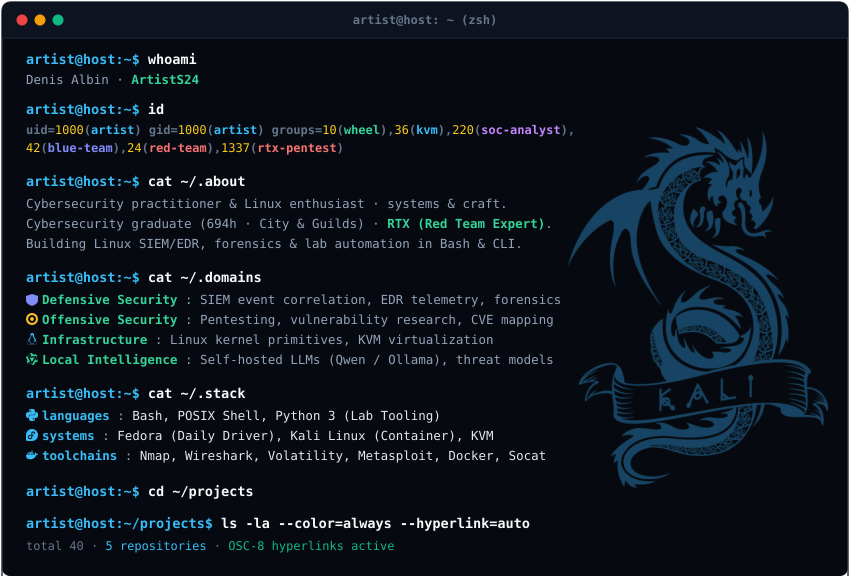
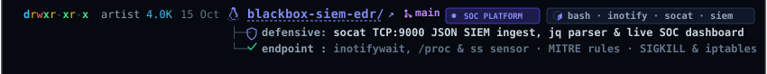
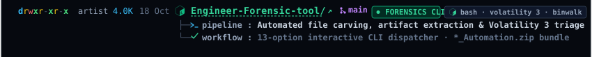
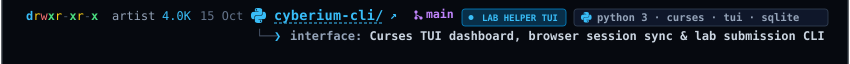
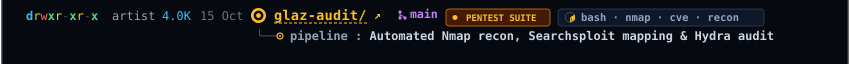
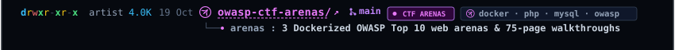
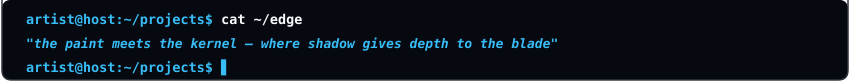

<div align="center">

<div align="center"><a href="https://github.com/ArtistS24"></a><a href="https://github.com/ArtistS24/blackbox-siem-edr" title="Open Flagship SOC Repository: blackbox-siem-edr"></a><a href="https://github.com/ArtistS24/Engineer-Forensic-tool" title="Explore Engineer Forensics Tool"></a><a href="https://github.com/ArtistS24/cyberium-cli" title="Explore Cyberium CLI Lab"></a><a href="https://github.com/ArtistS24/glaz-audit" title="Explore Glaz Audit Lab"></a><a href="https://github.com/ArtistS24/owasp-ctf-arenas" title="Explore OWASP CTF Arenas"></a><a href="https://github.com/ArtistS24"></a></div>

<br/>

[](https://digitalcredentials.cityandguilds.com/profile/denisalbin263984/wallet)
[](mailto:albindeniswork@gmail.com)

<br/>
<br/>

<p>
  
  <br/>
  <a href="https://github.com/ArtistS24/blackbox-siem-edr/blob/main/docs/Blackbox_SIEM_EDR_Portfolio.pdf"></a>
  <a href="https://github.com/ArtistS24/Engineer-Forensic-tool/blob/main/docs/Engineer_Portfolio.pdf"></a>
  <a href="https://github.com/ArtistS24/cyberium-cli/blob/main/docs/Cyberium_CLI_POC_Denis_Albin.pdf"></a>
  <a href="https://github.com/ArtistS24/glaz-audit/blob/main/docs/Glaz_Portfolio.pdf"></a>
  <a href="https://github.com/ArtistS24/owasp-ctf-arenas#walkthroughs"></a>
</p>

</div>

<details>
<summary><b>Plain-text terminal session</b></summary>

```bash
artist@host:~$ whoami
Denis Albin · ArtistS24

artist@host:~$ id
uid=1000(artist) gid=1000(artist) groups=10(wheel),36(kvm),220(soc-analyst),42(blue-team),24(red-team),1337(rtx-pentest)

artist@host:~$ cat ~/.about
Cybersecurity practitioner & Linux enthusiast · systems & craft.
Cybersecurity graduate (694h · City & Guilds) · Currently in RTX (Red Team Expert).
Building Linux SIEM/EDR, forensics & lab automation in Bash & CLI.

artist@host:~$ cat ~/.domains
[+] Defensive Security : SIEM log triage (Splunk / ELK), EDR telemetry, forensics
[+] Offensive Security : Network recon, Exploit-DB mapping, OWASP web labs
[+] Infrastructure     : Linux kernel primitives, KVM virtualization
[+] Alert & Log Triage : Windows Events, Sysmon, Linux auditd, Suricata / PCAP

artist@host:~$ cat ~/.stack
languages   : Bash, POSIX Shell, Python 3 (Lab Tooling)
systems     : Fedora (Daily Driver), Kali Linux (Container), KVM
toolchains  : Splunk, ELK, Wireshark, Volatility 3, Nmap, Docker

artist@host:~$ cd ~/projects

artist@host:~/projects$ ls -la --color=always --hyperlink=auto
total 40 · 5 repositories · OSC-8 hyperlinks active
drwxr-xr-x 2 artist 4.0K Oct 15 >_ blackbox-siem-edr/ ↗  ● SOC PLATFORM
  ├─ stack: bash | inotify | socat | siem
  ├─ defensive: socat TCP:9000 JSON SIEM ingest, jq parser & live SOC dashboard
  ├─ endpoint : inotifywait, /proc & ss sensor · MITRE rules · SIGKILL & iptables
  └─ Documentation: [  18-Page SIEM & EDR Architecture & PoC (PDF) ]

drwxr-xr-x 2 artist 4.0K Oct 18 >_ Engineer-Forensic-tool/ ↗  ● FORENSICS CLI
  ├─ stack: bash | volatility 3 | binwalk
  ├─ Automated file carving, artifact extraction & Volatility 3 memory triage
  ├─ Workflow: 13-option interactive CLI dispatcher · *_Automation.zip bundle
  └─ Documentation: [  13-Page Forensics Walkthrough & PoC (PDF) ]

drwxr-xr-x 2 artist 4.0K Oct 15 >_ cyberium-cli/ ↗  ● LAB HELPER TUI
  ├─ stack: python 3 | curses | tui | sqlite
  ├─ Curses TUI dashboard, browser session sync & lab submission CLI
  └─ Documentation: [  8-Page Curses TUI Walkthrough & PoC (PDF) ]

drwxr-xr-x 2 artist 4.0K Oct 15 >_ glaz-audit/ ↗  ● PENTEST SUITE
  ├─ stack: bash | nmap | cve | recon
  ├─ Automated Nmap recon, Searchsploit mapping & Hydra audit
  └─ Documentation: [  12-Page Pentest Walkthrough & CVE Mapping (PDF) ]

drwxr-xr-x 2 artist 4.0K Oct 19 >_ owasp-ctf-arenas/ ↗  ● CTF ARENAS
  ├─ stack: docker | php | mysql | sqlite | owasp
  ├─ arenas: 3 Dockerized OWASP Top 10 web apps (CorpLink, CorpNet, BrightBoard)
  └─ Documentation: [  7 Step-by-Step CTF Walkthrough PDFs (75 Pages) ]

artist@host:~/projects$ cat ~/edge
"the paint meets the kernel — where shadow gives depth to the blade"
```

</details>
