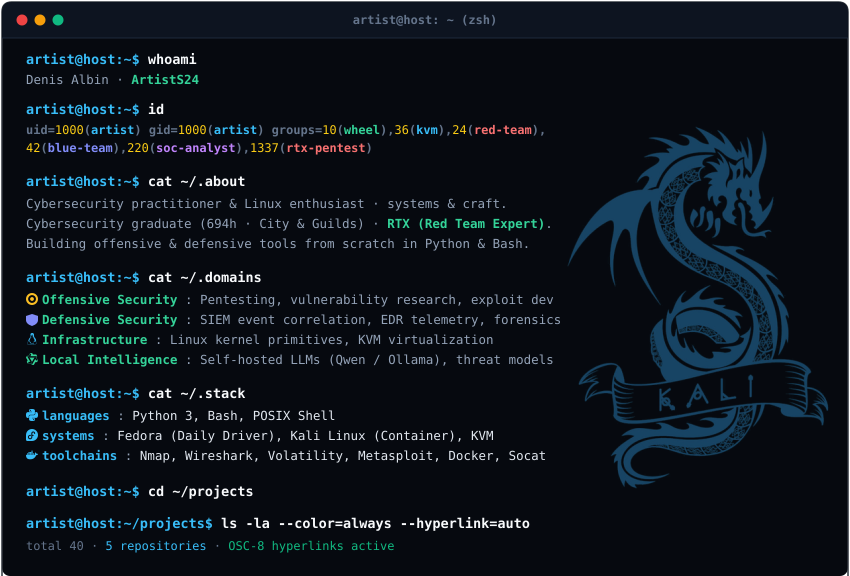
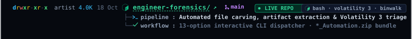
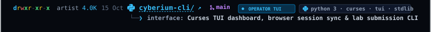
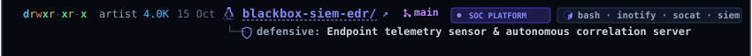
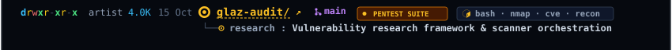
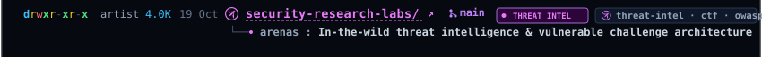
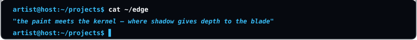

<div align="center">

<div align="center"><a href="https://github.com/ArtistS24"></a><a href="https://github.com/ArtistS24/Engineer-Forensic-tool" title="Open Flagship Repository: Engineer-Forensic-tool"></a><a href="https://github.com/ArtistS24/cyberium-cli" title="Explore Cyberium CLI Lab"></a><a href="https://github.com/ArtistS24/blackbox-siem-edr" title="Explore Black Box SIEM Lab"></a><a href="https://github.com/ArtistS24/glaz-audit" title="Explore Glaz Audit Lab"></a><a href="https://github.com/ArtistS24/security-research-labs" title="Explore Security Research &amp; Vulnerable Lab Arenas"></a><a href="https://github.com/ArtistS24"></a></div>

<br/>

[](https://digitalcredentials.cityandguilds.com/profile/denisalbin263984/wallet)
[](mailto:albindeniswork@gmail.com)

<br/>
<br/>

[-d97706?style=flat-square&logo=adobeacrobatreader&logoColor=white)](https://github.com/ArtistS24/Engineer-Forensic-tool/blob/main/Engineer.pdf)
<br/>
[-38bdf8?style=flat-square&logo=linux&logoColor=white)](https://github.com/ArtistS24/Engineer-Forensic-tool/blob/main/Engineer.pdf)
[-10b981?style=flat-square&logo=python&logoColor=white)](https://github.com/ArtistS24/cyberium-cli/blob/main/docs/Cyberium_CLI_POC_Denis_Albin.pdf)
[](https://github.com/ArtistS24/blackbox-siem-edr/blob/main/docs/NX220_SOC_Analyst_Accreditation.pdf)
[-f59e0b?style=flat-square&logo=security&logoColor=white)](https://github.com/ArtistS24/glaz-audit/blob/main/docs/Glaz_Portfolio.pdf)
[](https://github.com/ArtistS24/security-research-labs)

</div>

<details>
<summary><b>Plain-text terminal session</b></summary>

```bash
artist@host:~$ whoami
Denis Albin · ArtistS24

artist@host:~$ id
uid=1000(artist) gid=1000(artist) groups=10(wheel),36(kvm),24(red-team),42(blue-team),220(soc-analyst),1337(rtx-pentest)

artist@host:~$ cat ~/.about
Cybersecurity practitioner & Linux enthusiast · systems & craft.
Cybersecurity graduate (694h · City & Guilds) · Currently in RTX (Red Team Expert).
Building offensive & defensive tools from scratch in Python & Bash.

artist@host:~$ cat ~/.domains
[+] Offensive Security : Pentesting, vulnerability research, exploit dev
[+] Defensive Security : SIEM event correlation, EDR telemetry, forensics
[+] Infrastructure     : Linux kernel primitives, KVM virtualization
[+] Local Intelligence : Self-hosted LLMs (Qwen / Ollama), threat models

artist@host:~$ cat ~/.stack
languages   : Python 3, Bash, POSIX Shell
systems     : Fedora (Daily Driver), Kali Linux (Container), KVM
toolchains  : Nmap, Wireshark, Volatility, Metasploit, Docker, Socat

artist@host:~$ cd ~/projects

artist@host:~/projects$ ls -la --color=always --hyperlink=auto
total 40 · 5 repositories · OSC-8 hyperlinks active
drwxr-xr-x 2 artist 4.0K Oct 18 >_ engineer-forensics/ ↗  ● LIVE REPO
  ├─ stack: bash | volatility 3 | binwalk
  ├─ Automated file carving, artifact extraction & Volatility 3 memory triage
  ├─ Workflow: 13-option interactive CLI dispatcher · *_Automation.zip bundle
  └─ Documentation: [  13-Page Official Forensics Dossier & Proof of Concept ]

drwxr-xr-x 2 artist 4.0K Oct 15 >_ cyberium-cli  ● OPERATOR TUI
  ├─ stack: python 3 | curses | tui | stdlib
  ├─ Curses TUI dashboard, browser session sync & lab submission CLI
  └─ Documentation: [  8-Page Official POC Whitepaper & Curses TUI Spec ]

drwxr-xr-x 2 artist 4.0K Oct 15 >_ blackbox-siem-edr  ● SOC PLATFORM
  ├─ stack: bash | inotify | socat | siem
  ├─ Endpoint telemetry sensor & autonomous defensive correlation server
  └─ Documentation: [  Architecture Blueprint & NX220 SOC Analyst Spec ]

drwxr-xr-x 2 artist 4.0K Oct 15 >_ glaz-audit  ● PENTEST SUITE
  ├─ stack: bash | nmap | cve | recon
  ├─ Automated vulnerability research framework & scanner orchestration
  └─ Documentation: [  12-Page Official Pentest Dossier & CVE Methodology ]

drwxr-xr-x 2 artist 4.0K Oct 19 >_ security-research-labs  ● THREAT INTEL
  ├─ stack: threat-intel | ctf | owasp
  ├─ In-the-wild threat intelligence & vulnerable challenge architecture
  └─ Documentation: [  3 Red Team Manuals & 7 Challenge Walkthrough Dossiers ]

artist@host:~/projects$ cat ~/edge
the paint meets the kernel — where shadow gives depth to the blade
```

</details>
